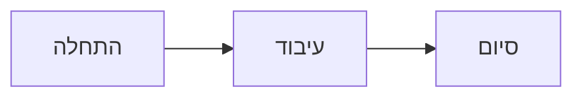

<style>
body {
    direction: rtl;
    text-align: right;
}

.ltr {
    direction: ltr;
    text-align: left;
}

pre, code {
    direction: ltr;
    text-align: left;
}
</style>

# בדיקת MARKDOWN בעברית 

הבוקר עלה לאיטו מעל הגבעות, ואור ראשון נפל על בתי הכפר ועל השדות שמסביב. הרחובות היו עדיין שקטים, ורק קול ציפורים ורחש הרוח בין העצים הפרו את הדממה. מן הבתים עלה ריח של קפה ולחם טרי, והיום החדש החל את דרכו בנחת.

בשעות הצהריים התמלאה הדרך באנשים. סוחרים פתחו את חנויותיהם, ילדים חזרו מבית הספר, ועוברי אורח עצרו לשוחח זה עם זה בצל העצים. ליד הבאר הישנה ישבו כמה מן הזקנים, כפי שנהגו לעשות שנים רבות, וסיפרו סיפורים על ימים רחוקים ועל אנשים שכבר אינם.

עם ערב נצבעו השמים באדום ובזהב, והשדות החשיכו בהדרגה. האנשים שבו לבתיהם, התריסים נסגרו והאורות נדלקו בזה אחר זה. השקט חזר אל הרחובות, והכפר שקע לאט בשנת הלילה, ממתין לבוקר שיבוא.

# בדיקת CODE 

```java
public class Book {
    private String title;

    public Book(String title) {
        this.title = title;
    }

    public String getTitle() {
        return title;
    }
}
```

# בדיקת תרשים 


