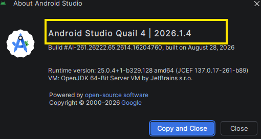
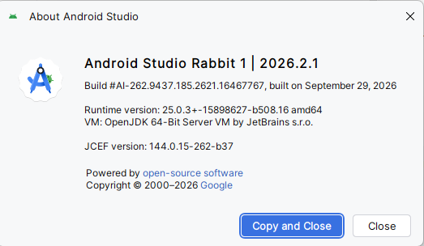
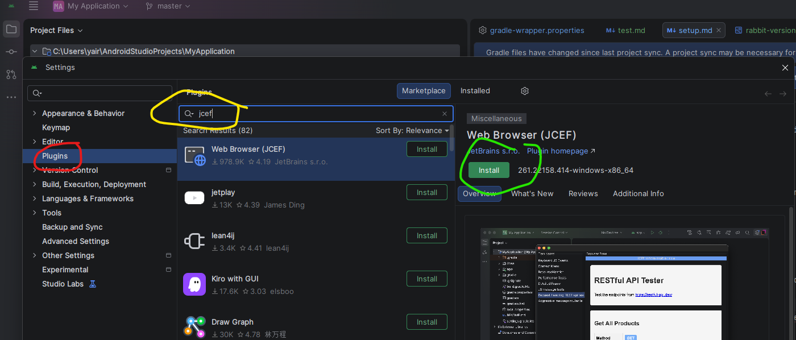
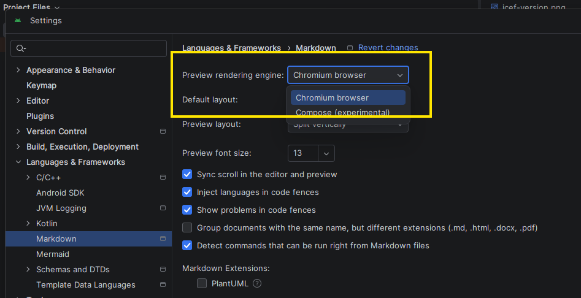
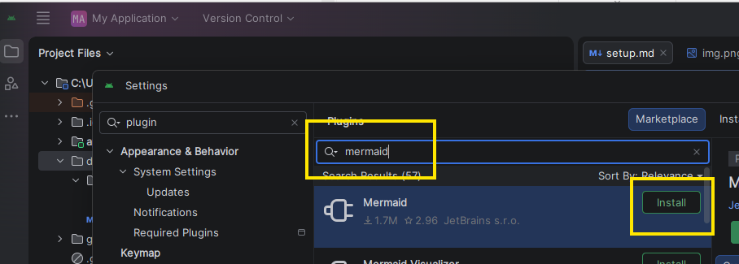
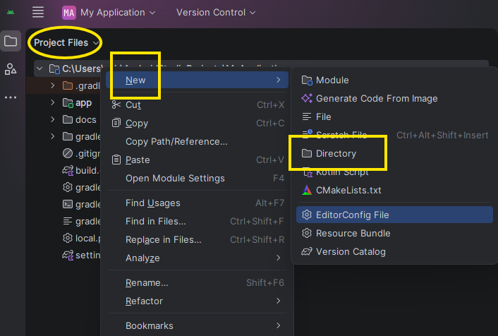
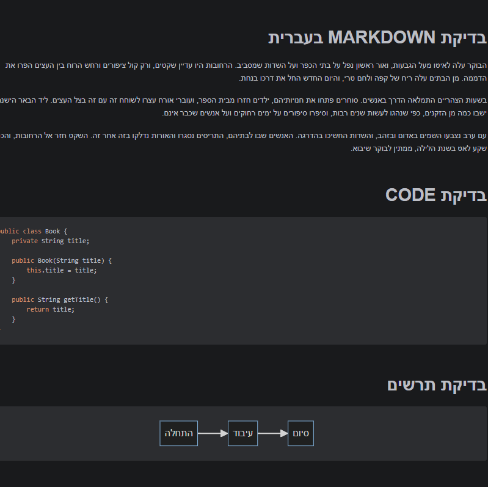

# הכנת ANDROID STUDIO לעבודה עם  Markdown 

Markdown הוא דרך פשוטה לכתיבת **תיעוד טכני מובנה באמצעות טקסט רגיל**.
במקום להשקיע זמן בעיצוב ובפורמט, משתמשים במספר קטן של כללים פשוטים ליצירת כותרות, רשימות, קישורים, תמונות, טבלאות וקטעי קוד.
קובצי Markdown נשארים קריאים וקלים לעריכה ישירות מתוך Android Studio או כל עורך טקסט אחר,
ולכן הם מתאימים במיוחד לכתיבת ספר פרויקט הכולל הסברים, תרשימים, צילומי מסך ודוגמאות קוד.

מכיוון ש-Markdown מבוסס על טקסט רגיל, הוא משתלב באופן טבעי עם **Git ועם תהליך פיתוח תוכנה**.
ניתן לעקוב אחר שינויים בדיוק כמו בקוד, לחלק את ספר הפרויקט למספר קבצים או פרקים,
ולבסוף להפיק מאותו תוכן **PDF, אתר HTML או מסמך בפורמט אחר**.
כך ניתן להפריד בין כתיבת התוכן לבין עיצוב והפקת המסמך הסופי, ולשמור את התיעוד כחלק בלתי נפרד מהפרויקט.

## Summary

- בדוק שיש לך גרסת חדשה של Android Studio. צריך להיות: Android Studio Quail 4 | 2026.1.4
- התקן את "JCEF Plugin" של JetBrain
- התקן את "Mermaid Plugin" של JetBrain
- שנה את תצוגת ה MARKDOWN ל- Google Chromium
- הגדר תקיית "DOCS" ל כתיבת מסמכים
- בדוק את השינויים

 

## Details

### 1. Check Android Studio Version.

Use "Help ... About" to check the version of your Android Studio.
Should be one of
1. `Android Studio Quail 4 | 2026.1.4` OR
2. `Android Studio Rabbit 1 | 2026.2.1`

Please avoid "Canary", "RC" releases - take only stable versions, or "patch-*" versions.

### 2. Install the `JCEF` plugin

The `JCEF Plugin` plugin provides web browser integration based on JCEF, a framework for embedding Chromium-based browsers in Java applications.

1. Choose "File ... Setting ... Plugins
2. Enter "Mermaid" - locate the `Mermaid` plugin provided by Jetbrains
3. Click "install".
4. Do not install any of the other plugins that are labeled "Mermaid".

### 2. Configure the Chrome Preview 

The default runtime for Android Studio is not configured for working with complex HTML.
There is an option to leverage the Chrome engine, making it possible to view complex documents with images, Right-To-Left text, etc.

1. Select "File ... Setting ... Markdown".
2. Check if the `Preview Rendering Engine`, is `Chromimum Browser` (and NOT `Compose (Experimentl)`)
3. Possible it's already set, in this case, no need to do anything.

### 3. Install the `Mermaid` plugin

The `Mermaid` tool supports diagrams such as flowcharts, sequence diagrams, state diagrams, class diagrams, and timelines. Because diagrams are stored as text, they are easy to edit, copy, and track with Git alongside the rest of the project documentation.

1. Choose "File ... Setting ... Plugins
2. Enter "Mermaid" - locate the `Mermaid` plugin provided by Jetbrains
3. Click "install".
4. Do not install any of the other plugins that are labeled "Mermaid".

### 4. Create "docs" folder - next to the "app" folder

 Change to "Project File View", and use "File ... New ... Directory" to create a directory "docs" next to the "app" folder.

## 5. Test

Create "test.md" file inside the newly create "docs" folder, and paste the test file into it. It should look like below

